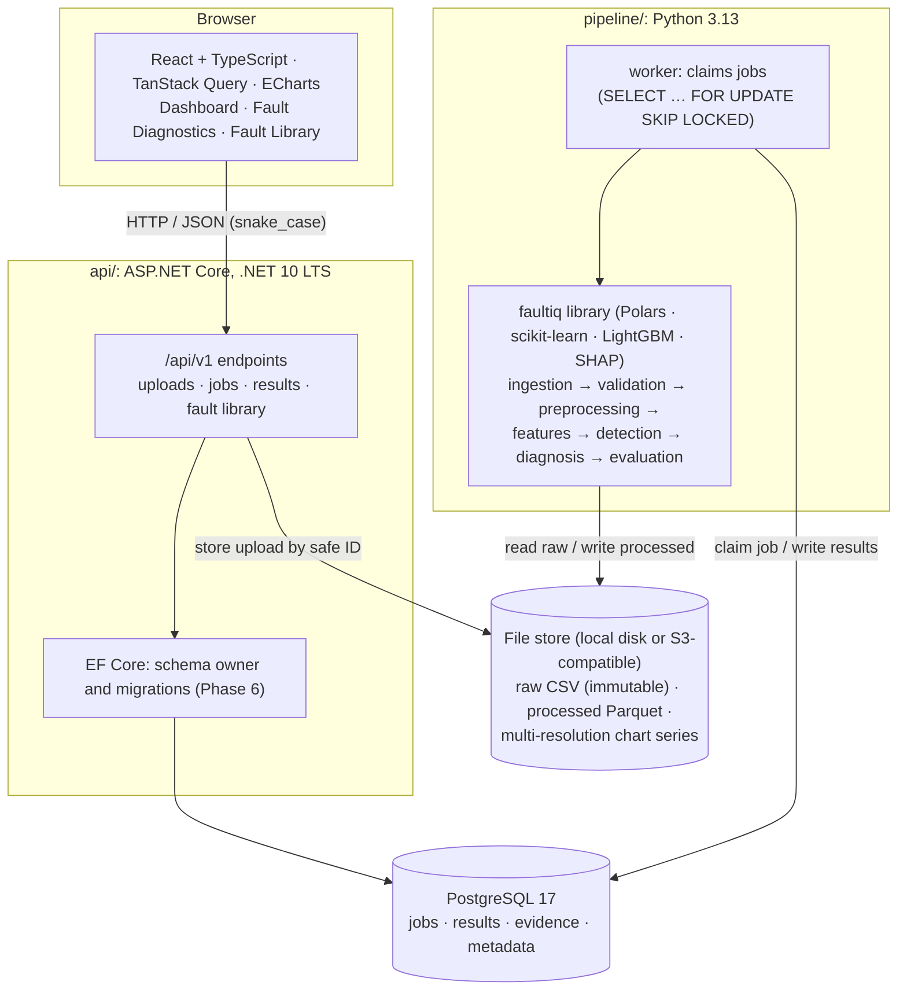

# Architecture

This is the initial architecture from Phase 0. Section 6 of [`FaultIQ_README.md`](../FaultIQ_README.md)
is the source plan. Decisions are recorded in [`decisions/`](decisions/README.md). The key one is
[ADR 0007](decisions/0007-hybrid-dotnet-api-python-pipeline.md): a hybrid of a .NET API and a Python pipeline.

## Runtime view



There are no direct calls between the API and the worker. PostgreSQL is the contract between them.

## Deployment view

Production and the public demo use `compose.prod.yml` ([ADR 0017](decisions/0017-deployable-demo-same-artifacts-as-self-hosting.md)):

```text
Internet ──443/80──▶ web (Caddy: HTTPS, static frontend, security headers)
                       └── /api/* ──▶ api (.NET) ──▶ postgres ◀── worker (Python)
                                       (internal network only)
```

`DEMO_MODE=true` makes the API read-only and shows a sample-data banner. Rate limiting is always on.

## Data flow (batch)

```text
[API]     CSV upload → safe ID + content hash → raw file stored unchanged → job row (queued)
[worker]  claim job → validation (schema, timestamps, units, missingness, labels) → report or quarantine
          → preprocessing (alignment, operating mode, steady state) → features
          → detection (rule baseline + evaluated ML) → diagnosis (supported class | inconclusive)
          → evidence + explanation (structured; an LLM may only phrase it)
          → downsampled chart series (LTTB, ~2k points per sensor per view) written as Parquet
          → results persisted with source ID + model_version + pipeline_version → job succeeded/failed
[API]     serves job status, results, evidence and ready-to-draw chart series to the frontend
          (raw time series never go to the browser; zoom uses precomputed resolution levels, ADR 0016)
```

## Performance principles

- **Compute once, serve many times.** Detection, diagnosis, SHAP attributions and chart series are
  computed by the worker and stored. API requests read stored results and never recompute them.
- **Small responses.** Results are paginated, and charts use downsampled series (ADR 0009).
- **Fast batch processing.** The pipeline uses lazy, multi-core Polars over Parquet (ADR 0010).
  Phase 2 measures processing time and reports it.
- **Fast frontend.** Screens and charts are lazy-loaded, and TanStack Query serves cached data
  while it refreshes (ADR 0008).
- **Measured, not assumed.** OpenTelemetry traces and metrics cover each request and job stage (ADR 0012).

## Ownership

| Concern | Owner |
|---|---|
| HTTP API, upload checks, authentication (ASP.NET Core Identity + optional OIDC), pagination | `api/` (.NET) |
| Database schema and migrations | `api/` (EF Core). The worker follows it, verified by a contract test |
| Features, models, inference, evaluation, explanations | `pipeline/` (Python) only |
| `pipeline_version`, `model_version` | `pipeline/`, written with every result |

## Boundaries

| Rule | Where it is enforced |
|------|----------------------|
| .NET never computes features or predictions | ADR 0007, code review |
| `faultiq` library has no database or web dependencies | review, later an import-lint check |
| Raw inputs are immutable | the API writes once; processed data goes to a separate location |
| Every inference records `model_version` and `pipeline_version` | result schema (Phase 5/6) |
| Model output is never shown as a confirmed root cause | separate `confirmed_label` field, UI wording |
| Clients never see stack traces, paths or secrets | Problem Details handler in `Program.cs` (tested) |

## Phase 0 status

Implemented so far:

- **API:** `GET /api/v1/health` (liveness), `GET /api/v1/health/ready` (database readiness), RFC 9457 errors with a
  `code` field, JSON logs, CORS, and OpenAPI at `/api/v1/openapi.json`.
- **Worker:** a stub that waits for the database, sends a heartbeat, shuts down cleanly on SIGTERM, and has a `--check` mode.
- **Frontend:** a shell that shows API status.
- **Docker Compose:** `postgres`, `api`, `worker` and `frontend`.
